# Qwent cards

# Monsters (32)

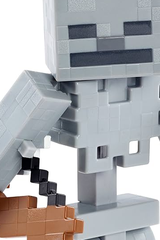

## Skeleton

**Power:** 4  
**Tags:** -  
On play: deal 3 damage to a monster.

 

---

*Flavor text:* 

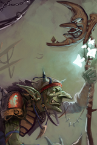

## Evil Goblin

**Power:** 8  
**Tags:** -  
No effect.

 

---

*Flavor text:* 

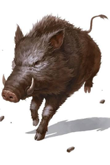

## Boar

**Power:** 4  
**Tags:** -  
On play: deal 1 damage to a monster.

 

---

*Flavor text:* 

## Bear

**Power:** 7  
**Tags:** -  
No effect.

 

---

*Flavor text:* 

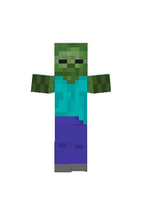

## Basic Zombie

**Power:** 2  
**Tags:** Zombie  
No effect.

 

---

*Flavor text:* 

## Leader Zombie

**Power:** 6  
**Tags:** Zombie  
When damaged and survives: summon a Basic Zombie on a random empty tile.

 

---

*Flavor text:* 

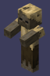

## Desert Zombie

**Power:** 5  
**Tags:** Zombie  
On play: deal 2 damage to a monster.

 

---

*Flavor text:* 

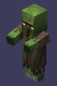

## Zombie Librarian

**Power:** 5  
**Tags:** Zombie  
On play: discard a Zombie card from your hand to draw a spell.

 

---

*Flavor text:* 

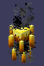

## Blaze

**Power:** 4  
**Tags:** -  
On play: deal 1 damage to a monster, twice (can be the same one).

 

---

*Flavor text:* 

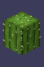

## Cactus

**Power:** 7  
**Tags:** Plant  
**Treacherous** – can also be played on your opponent's side.  
On play: deal 1 damage to the monsters left and right of it.

 

---

*Flavor text:* 

## Beetroot

**Power:** 1  
**Tags:** Plant  
**Treacherous** – can also be played on your opponent's side.  
No effect.

 

---

*Flavor text:* 

## Emerald

**Power:** 6  
**Tags:** -  
**Treacherous** – can also be played on your opponent's side.  
On play on your opponent's side: draw a card from their deck.

 

---

*Flavor text:* 

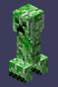

## Creeper

**Power:** 6  
**Tags:** -  
**Treacherous** – can also be played on your opponent's side.  
On death: destroy the monsters left and right of it.

 

---

*Flavor text:* 

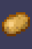

## Potato

**Power:** 1  
**Tags:** Plant  
On play: +3 power for every Potato in your graveyard.

 

---

*Flavor text:* 

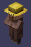

## Farmer

**Power:** 4  
**Tags:** -  
On play: banish a random Plant from your graveyard to play a Farmer.

 

---

*Flavor text:* 

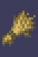

## Wheat

**Power:** 2  
**Tags:** -  
On play: banish a random Plant from your graveyard for +10 power.

 

---

*Flavor text:* 

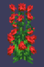

## Thorny Rose

**Power:** 6  
**Tags:** Plant  
On play: banish a random Plant from your graveyard to deal 4 damage to a monster.

 

---

*Flavor text:* 

## Brown Mushroom

**Power:** 3  
**Tags:** Plant  
On play: discard every Brown Mushroom from your deck.

 

---

*Flavor text:* 

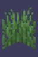

## Weeds

**Power:** 2  
**Tags:** -  
**Treacherous** – can also be played on your opponent's side.  
When your opponent casts a spell: put a Weeds on top of their deck.

 

---

*Flavor text:* 

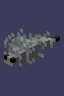

## Silverfish

**Power:** 1  
**Tags:** -  
No effect.

 

---

*Flavor text:* 

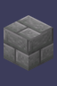

## Stone Bricks

**Power:** 3  
**Tags:** -  
**Treacherous** – can also be played on your opponent's side.  
On death: fill its row with Silverfish.

 

---

*Flavor text:* 

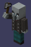

## Drunk Brawler

**Power:** 3  
**Tags:** -  
When damaged and survives: summon a Drunk Brawler.

 

---

*Flavor text:* 

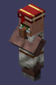

## Librarian

**Power:** 2  
**Tags:** -  
On play: discard a monster to draw a spell, or a spell to draw a monster.

 

---

*Flavor text:* 

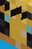

## Bee

**Power:** 5  
**Tags:** -  
On play: give a monster +2 power.

 

---

*Flavor text:* 

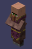

## Healer

**Power:** 6  
**Tags:** -  
On play: set the power of one of your monsters to 5.

 

---

*Flavor text:* 

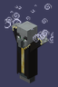

## Shaman

**Power:** 2  
**Tags:** -  
On play: give every monster in its row +2 power (itself too).

 

---

*Flavor text:* 

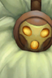

## Bard

**Power:** 3  
**Tags:** -  
On play: give a monster +1 power, twice (can be the same one).

 

---

*Flavor text:* 

## Warlock

**Power:** 9  
**Tags:** -  
On play: give an enemy monster +2 power.

 

---

*Flavor text:* 

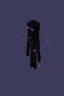

## Enderman

**Power:** 14  
**Tags:** -  
On play: discard a card.

 

---

*Flavor text:* 

## Shulker

**Power:** 4  
**Tags:** -  
On play: discard a card to deal 4 damage to 3 different enemy monsters.

 

---

*Flavor text:* 

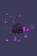

## Endermite

**Power:** 2  
**Tags:** -  
On play: discard a card to play 2 random monsters from your deck.

 

---

*Flavor text:* 

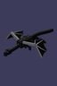

## Ender Dragon

**Power:** 27  
**Tags:** -  
On play: destroy every other monster in its column.

 

---

*Flavor text:* 

# Spells (21)

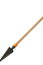

## Arrow

**Spell**  
**Tags:** -  
Deal 4 damage to a monster.

 

---

*Flavor text:* 

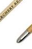

## Two Arrows

**Spell**  
**Tags:** -  
Deal 4 damage to two different monsters.

 

---

*Flavor text:* 

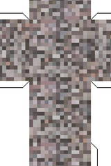

## Gravel

**Spell**  
**Tags:** -  
Destroy the lowest power monsters (all of them if tied).

 

---

*Flavor text:* 

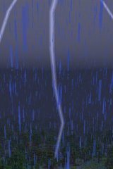

## Lightning

**Spell**  
**Tags:** -  
Destroy the highest power monsters (all of them if tied).

 

---

*Flavor text:* 

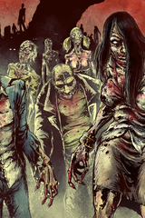

## Horde

**Spell**  
**Tags:** Zombie  
Play all Basic Zombies from your deck.

 

---

*Flavor text:* 

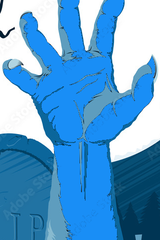

## Zombie Awakening

**Spell**  
**Tags:** Zombie  
Play all Basic Zombies from your graveyard.

 

---

*Flavor text:* 

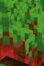

## Bad Farming

**Spell**  
**Tags:** -  
Fill your back row with Beetroots.

 

---

*Flavor text:* 

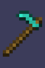

## Diamond Hoe

**Spell**  
**Tags:** -  
Put 3 copies of a monster on the board into your deck.

 

---

*Flavor text:* 

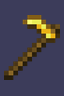

## Gold Hoe

**Spell**  
**Tags:** -  
Put 3 copies of a monster on the board into your graveyard.

 

---

*Flavor text:* 

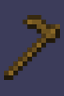

## Wooden Hoe

**Spell**  
**Tags:** -  
Destroy your monster to play a copy of it.

 

---

*Flavor text:* 

## Fertilizing

**Spell**  
**Tags:** -  
Discard 2 cards to draw 2 cards.

 

---

*Flavor text:* 

## Switcharoo

**Spell**  
**Tags:** -  
Swap your deck and your graveyard (no shuffling).

 

---

*Flavor text:* 

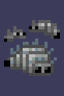

## Infestation

**Spell**  
**Tags:** -  
Shuffle 4 Silverfish into your opponent's deck.

 

---

*Flavor text:* 

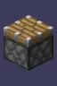

## Piston

**Spell**  
**Tags:** -  
Push a monster one row towards your opponent (monsters in the way are pushed along).

 

---

*Flavor text:* 

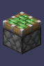

## Slime Piston

**Spell**  
**Tags:** -  
Discard a card to pull a monster one row towards you (monsters in the way are pushed along).

 

---

*Flavor text:* 

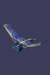

## Swarm

**Spell**  
**Tags:** -  
Play 3 Silverfish.

 

---

*Flavor text:* 

## Splash of Strength

**Spell**  
**Tags:** -  
Give all your monsters +2 power.

 

---

*Flavor text:* 

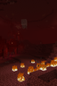

## Harsh World

**Spell**  
**Tags:** -  
Deal 2 damage to all monsters (both sides).

 

---

*Flavor text:* 

## Music Disc

**Spell**  
**Tags:** -  
If your graveyard has at least 2 Music Discs (this one counts), draw a card.

 

---

*Flavor text:* 

## Summon Ender Dragon

**Spell**  
**Tags:** -  
Discard 4 cards to play an Ender Dragon.

 

---

*Flavor text:* 

## Mirror

**Spell**  
**Tags:** -  
Banish the last spell that entered your opponent's graveyard to play it.

 

---

*Flavor text:* 

